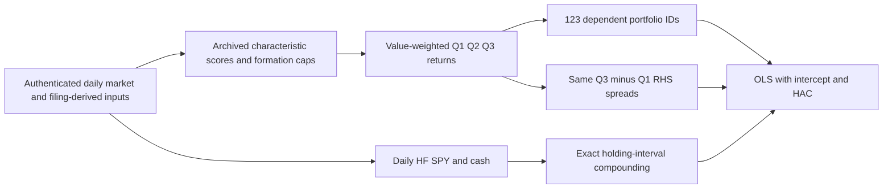

# Phase 2 asset-pricing validation

1 November 2026 (Asia/Calcutta). **PHASE2_CORRECTIONS_REQUIRED**.

All AP1-AP10 were investigated. The original research cache was located outside the Phase 1 checkout and authenticated for conditional numerical reconstruction. All 615 historical regressions, all 11,545 quantile returns and reported summary arithmetic were independently reproduced. A confirmed market/cash frequency mismatch was corrected in code. The resulting new regressions are **supplementary interval-alignment diagnostics on old, D8-affected quantile inputs**, not a corrected publication or validated investment finding.

Six issue investigations close with disclosed research limitations; AP1/AP2/AP5 remain NEEDS_REVIEW and AP10 is SOURCE_EVIDENCE_BLOCKED. The six checked boxes mean their specified investigation/disclosure is recorded, not approval of the whole empirical study. Independent human review is pending. No Phase 3 research work, manuscript/README rewrite or merge was performed.

## Baseline, source gate and preservation

- Repository: https://github.com/amitdudi 04/institutional-multi-factor-asset-pricing-platform
- Accepted Phase 1 baseline `10b3dc353f604ef332f55c153b093d1628a4ff7f`; new branch `research/institutional-phase2-asset-pricing-validation`. Original main `4e7fbdc380b8042db72e9c628260f60077a205ef`. Source correction checkpoint `62343e686475552a0b629d63b5445a6203ea90f7`; evidence is identified by the Git commit containing this report.
- Phase 1 branch and both older correction branches remain unchanged. Relevant interval-construction code from PR #8 was independently tested and reused only in the pricing input module; neither PR #7 nor PR #8 was merged. The proposed PR #8 ROE numerical substitution was deliberately not adopted.
- Source cache: `G:\4- Institutional Multi-Factor Asset Pricing & Portfolio Analytics Platform`. Its HEAD is `c778a12404596a1a936ec58ddba7750b8795a8c4`, with pre-existing modifications to API app/middleware and untracked frontend. These were preserved. Audit code executes from the separate branch, not that dirty checkout.
- Searches covered current/history manifests and output identities, the workspace data area, relevant G-drive project/data/output/interim directories, and FinanceResearch audit/review directory candidates. Exact matching frozen publications were found, so unrelated archives were not bulk-extracted. `rg` searches of ignored runtime data require `--no-ignore`; absence from Git is not absence from owner storage.
- Frozen factor publication `factor-5a73616f131fca2102fa2ca4141ad64f`: 34,341,456 factor rows, 11,545 portfolio rows, 487 security IDs. Frozen pricing publication `asset-pricing-c0a72fae5349f1048e18557250da1927`: 123 dependent IDs and five model families. Parent market 715,447 rows and fundamentals 37,273 rows authenticate with finalized lifecycle/source/raw/mapping/configuration evidence. The pricing manifest's parent hash matches the authenticated factor manifest.
- Authentication here means local archived manifest/byte identity, not external notarization, provider adjustment truth or strict point-in-time decision validity. D4/D8/D9/V1 are carried forward and not silently closed. Provider bytes, old CSV/Parquet/manifests, manuscripts and README remain unchanged.
- Required source classes and each used artifact's path, ID/parent, SHA256, dates/counts where applicable, completeness and use are in `PHASE2_SOURCE_MANIFEST.json`. Original independently persisted holding-decision records and complete approved H1/H3 decision evidence remain missing. Reconstructed memberships are new diagnostics, not mislabeled original decision files.

## AP1

Sources: `asset_pricing/inputs.py::build_research_panel`, new `_holding_period_market_factors`, `regression/engine.py::fit_regression`, and `config/asset_pricing.yaml` (full paths/lines in issue CSV).

The response is a quantile holding-period simple return minus cash. Models add an intercept, drop missing observations model by model, require 24 complete observations, and reject nonfinite/rank-deficient designs. Historical samples have 68-102 observations. Adjusted R2 uses `1-(1-R2)*(n-1)/(n-k)`, including the intercept in k. No alpha annualization is performed: reported alpha is decimal return per nominal monthly observation, converted to percent only for display.

The market input is imported HF SPY, not a screened-universe-weighted market. Authenticated SPY dataset `daily_market-ed1285b4d527b2a25910c0f2` has 4,171 rows and retrieval metadata dated 2026-08-12. All 2,128 distinct factor-market dates exactly match its adjusted-close percentage changes. Frozen raw SHA256 is `bc43aad556ecc1c9feba68cdddf260ff513557be4cdd3fbfc40e3f5b0dbba525`. Market and benchmark columns also coincide. The `adjusted_close` label does not by itself establish dividend-total-return validity. Cash is imported as daily simple returns; owner metadata describes strictly lagged DGS3MO conversion on a 252-session convention. This audit checks supplied-series identity/frequency arithmetic, not every upstream economic assumption in that conversion.

The old panel joined only the realization day's market excess and cash values to a multi-session portfolio return. The failed reference used two post-formation market returns -10%, +20% and cash 1%, 2%: correct cash is 3.02%, not 2%; correct market excess is 4.98%, not 18%. The correction compounds market and cash separately over `(formation_date, realization_date]` and subtracts their terminal simple returns; it does not compound daily excess returns. Spreads and dependent assets now align on both interval endpoints. Missing/invalid daily inputs fail closed. Supplied-calendar completeness and pre-decision availability remain upstream qualifications.

Original historical values are independently reproduced, including CAPM's low 0.06343952 adjusted R2:

| Model | Mean adj R2 | Mean alpha % | Mean abs alpha % | RMS alpha % | p<.05 /123 | N range |
| --- | --- | --- | --- | --- | --- | --- |
| capm | 0.06343952 | 1.187368 | 1.187368 | 1.222605 | 105 | 68-102 |
| fama_french_3 | 0.25850507 | 0.923057 | 0.923057 | 0.960651 | 72 | 68-90 |
| carhart_4 | 0.27658521 | 0.899097 | 0.899097 | 0.940896 | 65 | 68-90 |
| fama_french_5 | 0.30079138 | 1.055936 | 1.055936 | 1.086971 | 114 | 68-78 |
| hou_xue_zhang_q | 0.29573223 | 0.874903 | 0.874903 | 0.909254 | 72 | 68-90 |


Maximum discrepancies across all 615 independent fits: coefficients 2.66e-15; HAC SE 2.89e-15; p 8.24e-15; adjusted R2 4.44e-16; residual 3.33e-16. These verify what the archived implementation computed, not its correct time-unit interpretation.

**Conditional interval-alignment diagnostic**, with original quantile returns, factor mappings and model-specific availability retained:

| Model | Original adj R2 | Interval diagnostic adj R2 | Original alpha % | Interval diagnostic alpha % | Original/diagnostic nominal rejections |
| --- | --- | --- | --- | --- | --- |
| capm | 0.06343952 | 0.66149981 | 1.187368 | -0.011643 | 105/1 |
| fama_french_3 | 0.25850507 | 0.73055869 | 0.923057 | -0.137130 | 72/9 |
| carhart_4 | 0.27658521 | 0.74736576 | 0.899097 | -0.138503 | 65/9 |
| fama_french_5 | 0.30079138 | 0.81272823 | 1.055936 | -0.210514 | 114/10 |
| hou_xue_zhang_q | 0.29573223 | 0.75960641 | 0.874903 | -0.147118 | 72/10 |


The large differences demonstrate a real construction error. They are not new accepted paper numbers: old factor returns still contain incomplete holding histories, final partial-month observations and unresolved timing/vintage assumptions. No official corrected factor/pricing publication was created.

## AP2

Sources: `factors/portfolio.py::compute_factor_portfolios`, pricing input/service paths and frozen factor/pricing manifests. Forty-eight registry IDs minus six non-portfolio definitions minus non-estimable issuance gives 41 portfolio characteristics; three quantiles give 123 labeled dependent IDs. Formation uses month-end score ranks and positive-cap value weights. The declared score cross-section minimum is 3, which can produce singleton terciles. Daily factors have rolling warmups; fundamental availability differs across characteristics.

All 11,545 frozen group counts and value-weighted returns are reconstructed from factor scores, formation caps and genuine archived market paths. Maximum return difference is 5.55e-17. There are 3,895 formed factor/exit intervals: 3,825 complete Q1-Q3 triples and 70 single-quantile intervals. No observed two-leg spread uses noncanonical Q2-Q3 endpoints. The compact 123-row definition/breadth inventory is in the diagnostics CSV.

However, 265 quantile groups contain incomplete constituent paths (277 member/group occurrences, **not 277 unique securities**). Two formation dates have multiple realized end dates. Actual supplied intervals range 4-33 calendar days; the final sample ends on 2026-08-04. Phase 1's fail-closed D8 implementation would require defensible complete-calendar or terminal-event accounting instead of certifying these archived groups. Counts/returns reproduce the old algorithm; they do not establish independently persisted decisions, investability or strictly point-in-time availability. AP2 remains open.

## AP3

The same frozen quantiles generate both dependent assets and RHS high-minus-low returns. This is shared construction, beyond ordinary common market exposure. Size/ME and CMA/IA also reuse mappings across model families. Memberships are reconstructed consistently with all frozen counts/returns, but no independent original holdings snapshot was found.

For each available interval and alias, overlap is the dependent portfolio's weight invested in securities appearing in either RHS Q1/Q3 leg. It is a union-of-constituents measure, not net long-short exposure or causal fit attribution. Means weight each available asset-interval comparison equally; alias results are not independent experiments:

| Alias | Available intervals | Asset-interval comparisons | Mean weight overlap | Median weight overlap |
| --- | --- | --- | --- | --- |
| SMB | 102 | 11475 | 0.8035 | 0.8489 |
| HML | 90 | 10785 | 0.6137 | 0.6680 |
| MOM | 90 | 10785 | 0.5424 | 0.5909 |
| RMW | 78 | 9564 | 0.2640 | 0.2309 |
| CMA | 90 | 10785 | 0.5480 | 0.6029 |
| ME | 102 | 11475 | 0.8035 | 0.8489 |
| IA | 90 | 10785 | 0.5480 | 0.6029 |
| ROE | 90 | 10785 | 0.4864 | 0.4990 |


A deterministic representative date, 2022-05-31 (middle formation date), gives 984 comparisons with mean overlap 0.6128445 and range 0-1 (floating roundoff above 1 is immaterial). All-available-interval summaries supplement that snapshot. Reused legs can mechanically relate fits: on an identical sample with a RHS `x=y_H-y_L`, OLS linearity implies the H/L coefficient difference on x is 1 and corresponding residual difference is 0, provided the same full design is used. This identity is distinct from genuine systematic exposure and does not by itself prove all fit is mechanical. No disjoint-universe or external-factor experiment was introduced.



## AP4

The stable historical ID `hou_xue_zhang_q` is a **study-specific q-style mapping**. Configured ME is a return spread sorted on log market cap, IA a spread sorted on asset growth, and the ROE alias a spread sorted on earnings yield. These are return factors in decimal units, not raw firm characteristics inserted directly into a regression. Direction conventions make size small-minus-large and investment low-growth-minus-high-growth.

Conventional q construction uses joint size/investment/profitability portfolios and quarterly earnings relative to lagged book equity, rather than a market-cap earnings yield. The study's simple monthly terciles, annual SEC fields and availability rules do not reproduce those joint sorts or fiscal timing. Even substituting the registry's annual accounting `roe` would not establish exact replication. Primary definitions: [author technical document](https://global-q.org/uploads/1/2/2/6/122679606/factorstd_2020july.pdf), [original working paper](https://www.nber.org/system/files/working_papers/w18435/revisions/w18435.rev0.pdf), [author factor page](https://global-q.org/factors.html). Indexed primary text was available; direct web opening of the technical PDFs failed, so no full document visual review is claimed.

The original PDF section 7.5 already calls this a study-specific proxy and expressly disclaims exact replication. No contrary claim in that paragraph is alleged. Historical model/alias IDs and `ROE: earnings_yield` remain unchanged. Config comments, registry comments and future publication assumptions now disclose the interpretation. Canonical numerical configuration hash remains `734e675a123eddae5cc25ff3008e5b453f66f5696c42ea3af847bc3c4b321268`. No manuscript or README was edited.

## AP5

The intercept is OLS alpha with an added constant. The exact archived estimator uses Newey-West Bartlett score covariance with correction n/(n-k), t=estimate/SE and two-sided Student-t p-values with n-k degrees of freedom. The minimum 24, actual sample counts, missingness and model-specific calendars are recorded. The nominal threshold is p<.05 with 123 intercepts per model. Independent matrix calculations reproduce all eligible estimates, SEs and p-values; CAPM 105/123=85.36585% and FF5 114/123=92.68293% explain the rounded claims.

The original PDF section 7.6 already defines these as nominal shares and excludes an investable-alpha interpretation. That percentage calculation is verified; the confirmed defect concerns its input construction. They are nominal shares, not FDR-controlled discoveries. Exploratory per-model BH rejection counts are CAPM 101, FF3 10, Carhart 8, FF5 110, q 12. Across all 615 tests, nominal 428, descriptive BH 298, Holm 0 and Bonferroni 0. These are supplementary arithmetic on authenticated historical p-values, not a retroactive approved testing family. BH's required dependence conditions are not established; even FWER arithmetic cannot repair invalid return construction or guarantee economically meaningful alpha.

The interval diagnostic reduces CAPM nominal rejections to 1 and FF5 to 10 on retained old quantiles. This is strong evidence of sensitivity to the confirmed measurement error, not final corrected inference. AP5 stays open pending valid upstream returns and reviewed publication propagation.

## AP6

Time-series fit and pricing errors answer different questions. With an intercept, `alpha=mean(y)-beta*mean(X)`. R2 measures centered explained variation; adding factors can improve it while their means and estimated loadings shift alpha away from zero. Adjusted R2 penalizes added parameters but does not constrain intercept magnitude. Signed, mean absolute and RMS alpha must be considered separately from fit and from t-statistics.

All historical alphas are positive, so their signed and absolute means coincide. FF3's mean 0.923057% is below FF5's 1.055936%, although FF5 has higher adjusted R2. On identical historical per-asset calendar intersections, FF3's mean becomes 1.002030% and remains below FF5's 1.055936%; sample composition explains part, not all, of the difference.

An eight-observation synthetic orthogonal reference confirms the algebra: with x=+/-1% alternating, z=-0.8% plus an orthogonal +/-0.4% pattern, e an orthogonal +/-0.05% pattern and y=1%+x+z+e, a one-factor regression has alpha 0.2%, adjusted R2 .83691756; adding z gives alpha 1%, adjusted R2 .99698925. This is a labeled mathematical reference, not an empirical study result. Higher FF5 fit alone cannot rank pricing success.

## AP7

The Bartlett sandwich is independently checked at lags 0,3,6,12 on a 48-observation deterministic fixture. Authentic archived residual and regressor-score series support the same small predefined sensitivity comparison. Actual retained regression samples have no missing or repeated calendar months; the terminal return may still cover a partial month.

| Model | L=0 significant | L=3 significant | L=6 significant | L=12 significant | Mean residual ACF 1 |
| --- | --- | --- | --- | --- | --- |
| capm | 81 | 105 | 106 | 109 | -0.075170 |
| fama_french_3 | 43 | 72 | 74 | 79 | -0.085840 |
| carhart_4 | 38 | 65 | 68 | 78 | -0.077134 |
| fama_french_5 | 84 | 114 | 116 | 118 | -0.116094 |
| hou_xue_zhang_q | 37 | 72 | 74 | 83 | -0.070002 |


Point estimates do not change with covariance lag. Larger lag does not automatically raise SEs: the covariance depends on regressor-weighted score autocovariances, which can be negative. Short samples 68-102 observations and the original frequency mismatch limit scientific interpretation. Lag 3 is preserved, not selected for a preferred p-value; neither favorable sensitivity nor formal optimality is claimed.

## AP8

All 7,503 return pairs have at least 24 shared observations. Mean correlation .76588985, median .77705309, range .22948374-1, with 47 absolute correlations>.95. Six return-name pairs coincide within 1e-12 on shared observations: log_market_cap versus market_cap in Q1/Q2/Q3, and rolling_beta versus rolling_market_beta in Q1/Q2/Q3. Missing-date patterns are not assumed identical beyond the measured overlap.

Mean archived residual correlation is .744397 CAPM, .737370 FF3, .752714 Carhart, .811823 FF5 and .746560 q. Correlation summaries are descriptive; some residual commonality may be caused by the frequency error itself. Shared constituents, ranks, periods and repeated legs make 123 regression IDs dependent. No effective-independent-test count is asserted. A valid individual portfolio's HAC inference is not a valid independent-binomial inference about all portfolios.

## AP9

The model panel forms a union of mapped spread dates, after which each model applies its own complete-case filter. All five families estimate 123 asset IDs, but 102 IDs have different date-set hashes across families. CAPM has 68-102 observations, FF5 68-78. Exactly matched per-asset intersections have 68-78 observations for every family; assets can still have different history lengths from one another.

| Model | Historical unmatched adj R2 | Historical common adj R2 | Interval-aligned common adj R2 | Common N range |
| --- | --- | --- | --- | --- |
| capm | 0.06343952 | 0.08291435 | 0.74343802 | 68-78 |
| fama_french_3 | 0.25850507 | 0.28359767 | 0.78953463 | 68-78 |
| carhart_4 | 0.27658521 | 0.29401477 | 0.80110267 | 68-78 |
| fama_french_5 | 0.30079138 | 0.30079138 | 0.81272823 | 68-78 |
| hou_xue_zhang_q | 0.29573223 | 0.34568446 | 0.80385669 | 68-78 |


The first common-sample control retains the original input-frequency error solely to isolate sample composition. The second combines interval alignment with the common sample, while still retaining original D8-affected quantile returns. Both are new supplementary diagnostics. The original table is not a controlled same-month model comparison. No published historical table or default estimator was silently replaced.

## AP10

H1 concerns at least one directional characteristic spread after approved costs and multiplicity control. H3 concerns the original temporal-stability/break decision, not mere existence of rolling coefficients. Genuine original rolling output is available, but complete approved factor-level cost/FDR and temporal-stability decision evidence was not found in the bound output set or targeted policy/artifact searches.

The historical PROJECT_SPECIFICATION section 6 labels policy `PROPOSED - OWNER APPROVAL REQUIRED` and economic materiality OPEN. Its H3 is a stability null versus material instability alternative, while the later paper phrases H3 as stable estimated relations. That direction/approval ambiguity must not be resolved after seeing results. H1 and H3 remain **INCONCLUSIVE**; original author-approved rules/decision artifacts remain source-blocked. Exploratory alpha BH calculations do not complete a factor-premium H1 test or a regime-stability H3 test.

## Validation, issue status and Phase 3 dependency gate

| Issue | Status | Checkbox |
| --- | --- | --- |
| AP1 | NEEDS_REVIEW | unchecked |
| AP2 | NEEDS_REVIEW | unchecked |
| AP3 | RESEARCH_LIMITATION_DISCLOSED | checked |
| AP4 | RESEARCH_LIMITATION_DISCLOSED | checked |
| AP5 | NEEDS_REVIEW | unchecked |
| AP6 | RESEARCH_LIMITATION_DISCLOSED | checked |
| AP7 | RESEARCH_LIMITATION_DISCLOSED | checked |
| AP8 | RESEARCH_LIMITATION_DISCLOSED | checked |
| AP9 | RESEARCH_LIMITATION_DISCLOSED | checked |
| AP10 | SOURCE_EVIDENCE_BLOCKED | unchecked |


- Before correction: 1 failed/4 passed; the failed exact-interval cash reference demonstrated the input defect.
- Targeted final: 35 passed in 6.83s, with independent OLS/HAC/adjustedR2/p checks and adversarial input boundaries.
- Full suite once: 343 passed, 115 warnings in 450.27s (7m30s),90.58% branch-aware coverage;90% gate and separate coverage report pass.
- Ruff lint/format, strict mypy 113 source files, lock verification and unchanged numerical q configuration pass. Full stdout and exact commands are in PHASE2_TEST_RESULTS.txt. No new remote CI run is inferred from a research-branch push.
- Source cache bytes are preserved; no raw third-party data or individual memberships are published. Only the six requested Phase 2 files and the same master tracker are audit deliverables. Code/test changes are narrowly scoped to the confirmed pricing input error and accurate q descriptions.

**Phase 3 must wait for independent review and defensible upstream reconstruction.** Resolve D8's incomplete holding histories/terminal evidence and final-period convention; authenticate strict decision-time availability and original price/return basis under D4/V1; retain D9's factor-overlap qualification; generate new immutable factor and pricing publications and propagate genuinely affected outputs. Do not relabel the supplementary interval table as fully corrected study evidence. Original policy/decision evidence is needed for H1/H3. Later portfolio/ML validation was not started.

## Reproduction method and evidence identities

Audit working drivers, hashes and exact local source paths are listed in the source manifest. They operate read-only on the owner cache and do not republish raw inputs. Core independent reference arithmetic is also tested in `tests/test_research_phase2_audit.py`. For each historical asset/model, apply the original complete-case row selection, form X=[1,factors], compute beta by NumPy least squares, e=y-X beta, scores=X*e, and:

```text
S = scores' scores
for j=1..L:
    Gamma = scores[j:]' scores[:-j]
    S += (1-j/(L+1)) * (Gamma + Gamma')
V = inverse(X'X) * S * inverse(X'X) * n/(n-k)
SE = sqrt(diag(V)); t = beta/SE
p = 2 * StudentT_survival(abs(t), df=n-k)
adjusted_R2 = 1-(1-R2)*(n-1)/(n-k)
```

Dates are sorted as in the frozen panel. Historical membership replay uses frozen month-end score ranks, positive formation market caps, the archived future inner join and security-specific exits, then compares every count and weighted compound against the original portfolio artifact. That replay exposes the old D8 behavior; it does not endorse it. Diagnostic correlations use shared observations; overlap uses reconstructed weights and RHS constituent unions. Per-asset results, date-set hashes, inventory, lag summaries, dependence and overlap metrics are retained in the diagnostics CSV. Every numerical reconciliation row explicitly states its source category. No independent empirical coefficient is claimed without authenticated input bytes.
